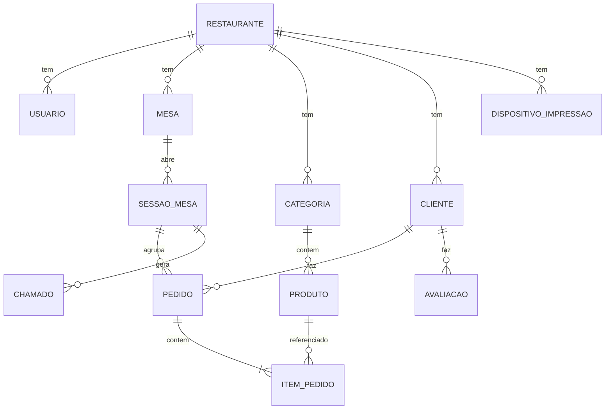

# Modelo de Dados — QRMesa

Todas as tabelas de negócio têm `RestauranteId` (multi-tenant), `CriadoEm` e `AtualizadoEm`. IDs em `Guid`.

## Diagrama

## Entidades

### Restaurante
| Campo | Tipo | Observação |
|---|---|---|
| Id | Guid | PK |
| Nome | string(120) | |
| Slug | string(60) | único, usado em URLs |
| LogoUrl | string? | |
| CorPrimaria | string(7) | ex.: `#1F3A5F` |
| PermiteObservacao | bool | "NÃO FAZEMOS ALTERAÇÕES" → false |
| EsperaMediaMinutos | int | exibido no cabeçalho |
| LinkAvaliacaoGoogle | string? | |
| Ativo | bool | |

### Usuario (equipe)
| Campo | Tipo | Observação |
|---|---|---|
| Id, RestauranteId | Guid | |
| Nome, Email | string | email único |
| SenhaHash | string | via ASP.NET Identity |
| Papel | enum | Dono, Gerente, Cozinha, Garcom, Caixa |

### Mesa
| Campo | Tipo | Observação |
|---|---|---|
| Id, RestauranteId | Guid | |
| Numero | int | único por restaurante |
| QrToken | string(32) | aleatório, único, não sequencial |
| Ativa | bool | |

### SessaoMesa
| Campo | Tipo | Observação |
|---|---|---|
| Id, RestauranteId, MesaId | Guid | |
| AbertaEm | DateTime | |
| FechadaEm | DateTime? | null = aberta |
| StatusConta | enum | Aberta, ContaSolicitada, Paga |

### Cliente
| Campo | Tipo | Observação |
|---|---|---|
| Id, RestauranteId | Guid | |
| Telefone | string(13) | só dígitos, `5512996816812`; único por restaurante |
| Nome | string(80) | |
| ConsentimentoLgpdEm | DateTime | |
| UltimaVisitaEm | DateTime | |

### Categoria
| Campo | Tipo | Observação |
|---|---|---|
| Id, RestauranteId | Guid | |
| Nome | string(60) | Porções, Pratos individuais... |
| Ordem | int | ordem das abas |
| Ativa | bool | |

### Produto
| Campo | Tipo | Observação |
|---|---|---|
| Id, RestauranteId, CategoriaId | Guid | |
| Nome | string(100) | |
| Descricao | string(500) | |
| Preco | decimal(10,2) | |
| ImagemUrl | string? | |
| Ordem | int | |
| Ativo | bool | aparece no cardápio |
| Esgotado | bool | aparece desabilitado |

### Pedido
| Campo | Tipo | Observação |
|---|---|---|
| Id, RestauranteId, SessaoMesaId, ClienteId | Guid | |
| Numero | int | sequencial por restaurante/dia (para a cozinha) |
| Status | enum | Recebido, EmPreparo, Pronto, Entregue, Cancelado |
| Total | decimal(10,2) | soma dos itens |
| StatusImpressao | enum | Pendente, Impresso, Falhou |
| CriadoEm | DateTime | |

### ItemPedido
| Campo | Tipo | Observação |
|---|---|---|
| Id, PedidoId, ProdutoId | Guid | |
| NomeProduto | string | **cópia** do nome no momento do pedido |
| PrecoUnitario | decimal(10,2) | **cópia** do preço no momento do pedido |
| Quantidade | int | > 0 |
| Observacao | string(200)? | só se o restaurante permitir |
| Subtotal | decimal(10,2) | PrecoUnitario × Quantidade |

### Chamado
| Campo | Tipo | Observação |
|---|---|---|
| Id, RestauranteId, SessaoMesaId | Guid | |
| Tipo | enum | Garcom, Conta |
| Atendido | bool | |
| CriadoEm, AtendidoEm | DateTime | |

### Avaliacao
| Campo | Tipo | Observação |
|---|---|---|
| Id, RestauranteId, ClienteId, SessaoMesaId | Guid | |
| Nota | int | 1 a 5 |
| Comentario | string(500)? | |

### DispositivoImpressao
| Campo | Tipo | Observação |
|---|---|---|
| Id, RestauranteId | Guid | |
| Nome | string | "Cozinha principal" |
| ChaveHash | string | chave do agente (guardar só o hash) |
| UltimoContatoEm | DateTime? | para mostrar online/offline no painel |

## Índices importantes
- `Cliente (RestauranteId, Telefone)` único
- `Mesa (QrToken)` único
- `Mesa (RestauranteId, Numero)` único
- `Pedido (RestauranteId, CriadoEm)` para relatórios
- `Pedido (RestauranteId, StatusImpressao)` para a fila de impressão
